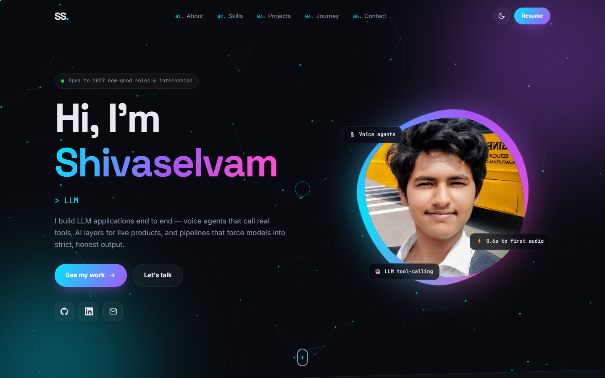

# Shivaselvam S — Portfolio

**Live:** [shivssv1269.github.io](https://shivssv1269.github.io)

Personal portfolio of Shivaselvam S, a 2027 B.Tech Computer Science & Business Systems student who builds LLM applications end to end: voice agents, tool-calling, structured-output pipelines and live AI products.

## Built with
- Hand-written HTML, CSS and vanilla JavaScript, with no frameworks and no build step
- Canvas particle network, scroll-triggered reveals, 3D card tilt and a light/dark theme
- Responsive from phone to desktop, and respects `prefers-reduced-motion`
- Hosted on GitHub Pages

## Contact
[LinkedIn](https://www.linkedin.com/in/shivaselvam-s-178a333a7) · [GitHub](https://github.com/SHIVSSV1269) · shivaselvamssv@gmail.com
